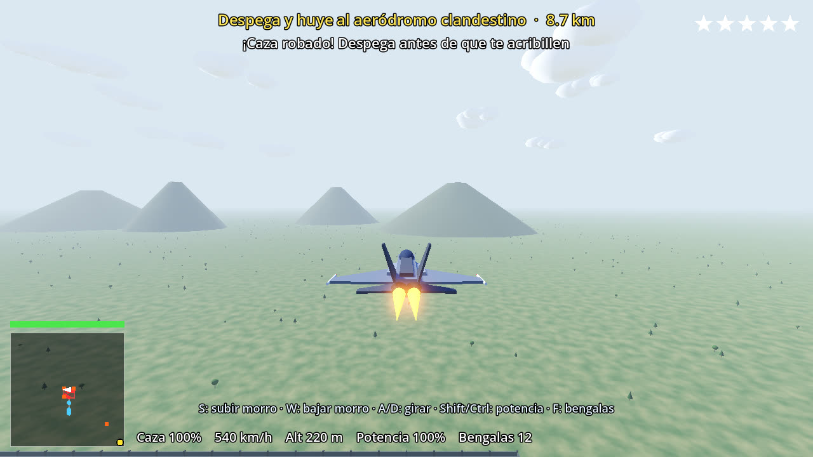

# Operación Halcón

Juego de acción 3D en tercera persona hecho con Godot 4.7: roba un coche, cuélate en una base aérea, roba un caza y huye de los misiles hasta un aeródromo clandestino. Una partida dura unos 5 minutos.

Juego original. Todo el mundo se genera por código con primitivas (sin modelos externos); el sonido y la música están generados con IA (ver `docs/CREDITS.md`).

**Descargas (Windows, macOS y Linux):** https://halcon.enguillem.es



## Jugar desde el código

Necesitas [Godot 4.7](https://godotengine.org/download).

```bash
git clone https://github.com/canalenguillem/operacion-halcon.git
cd operacion-halcon
godot --path .
```

## Controles

| Modo | Teclas |
|---|---|
| A pie | WASD mover · ratón cámara · clic disparar · Shift correr · Espacio saltar · E subir a un vehículo |
| Coche | W/S acelerar y marcha atrás · A/D girar · Espacio freno · E bajar |
| Caza en tierra | W acelerar (despega solo a 250 km/h) · S frenar · A/D girar |
| Caza en vuelo | S subir el morro · W bajarlo · A/D girar · Shift/Ctrl potencia · F bengalas |
| General | Esc pausa · R reiniciar |

## Cómo está hecho

- GDScript con tipado estático obligatorio.
- Cada actor tiene tres piezas: nodo, lógica pura con tests (GUT) y datos en un Resource `.tres`.
- `./tools/check.sh` carga todo el proyecto, arranca la misión sin pantalla y lanza los tests.

Documentación: [diseño](docs/GDD.md), [arquitectura](docs/ARCHITECTURE.md), [hitos](docs/ROADMAP.md).
